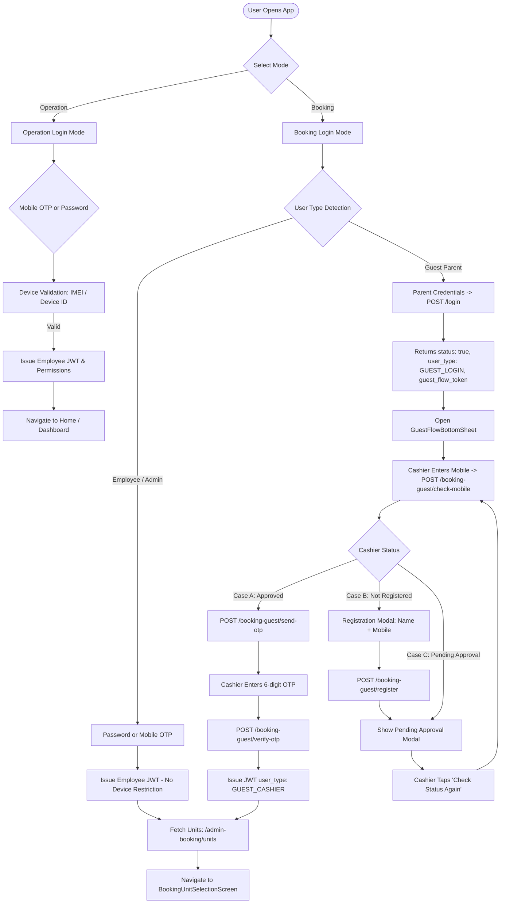

# Authentication & Booking Login Module Documentation

> **Status:** Active / Living Specification  
> **Package:** `packages/apps/mfresh_ops`  
> **Module Path:** `lib/modules/authentication/`  
> **Documentation Location:** `documentation/authentication/AUTHENTICATION.md`  
> **Last Updated:** October 2026  
> **Maintainer:** Banamali Nayak

---

## 1. Overview & Scope

The **Authentication** module serves as the primary gateway for identity, authorization, device binding, and role separation across the `mfresh_ops` application.

Beginning in October 2026, the application supports two top-level operational branches at login:
1. **Operation Mode (`operation`)**: Dedicated for internal employees, field supervisors, technicians, and operators. Enforces hardware identification (device IMEI / device ID check), attendance checking, and standard JWT access with granular RBAC permissions.
2. **Booking Mode (`booking`)**: Bypasses device restrictions and provides access for booking creation, unit ticket sales, and cashier counters. Caters to:
   - **Internal Employees / Admins**: Direct password or mobile OTP verification.
   - **Guest Parents & Cashiers**: Two-tier verification where Guest Parent credentials grant temporary access (`guest_flow_token`), allowing a physical cashier to register/verify via mobile OTP, ultimately issuing a `GUEST_CASHIER` scoped JWT with parent-restricted unit access.

---

## 2. Directory Structure & File Map

```
packages/apps/mfresh_ops/
├── documentation/
│   └── authentication/
│       └── AUTHENTICATION.md                     # [This File] Master authentication & booking documentation
├── lib/
│   ├── core/
│   │   └── constants/
│   │       └── app_constants.dart                # API endpoints and storage keys
│   ├── data/
│   │   ├── models/
│   │   │   ├── user_model.dart                   # UserModel serialization
│   │   │   ├── unit_model.dart                   # UnitModel with nested unit & qrcode parsing
│   │   │   └── booking_guest_auth_models.dart    # GuestCheckMobileResult, GuestSendOtpResult, BookingSessionModel
│   │   └── repositories/
│   │       ├── auth_repository.dart              # Core Auth & Attendance repository (GetxService)
│   │       └── booking_repository.dart           # Booking unit fetching & cart operations
│   └── modules/
│       └── authentication/
│           ├── controllers/
│           │   ├── login_controller.dart         # Main login state machine (Operation & Booking)
│           │   └── guest_flow_controller.dart    # Embedded in guest_flow_bottom_sheet
│           └── views/
│               ├── login_screen.dart             # Responsive dual-mode login UI
│               └── widgets/
│                   └── guest_flow_bottom_sheet.dart # Multi-step Guest Cashier mobile verification & OTP modal
```

---

## 3. Top-Level Login Modes



---

## 4. API Endpoints Reference

Base URL is typically configured as `https://your-domain.com/api`.

### 4.1 Login & Employee Booking

| Action | HTTP Method | Endpoint | Request Headers / Body | Key Response Fields |
|---|---|---|---|---|
| **Standard / Booking Login** | `POST` | `/login` | `{"user_id": "...", "password": "...", "login_mode": "booking"}` (or `"operation"`) | Employee: `token`, `user`, `permissions`<br>Guest: `status: true`, `user_type: "GUEST_LOGIN"`, `guest_flow_token` (valid 20m), `guest_parent` |
| **Booking Send OTP** | `POST` | `/booking/send-otp` | `{"mobile": "9876543210"}` | `status: true`, `message: "OTP sent..."`, `expires_in: 300` |
| **Booking Verify OTP** | `POST` | `/booking/verify-otp` | `{"mobile": "9876543210", "otp": "123456"}` | `status: true`, `token`, `user`, `user_type`, `permissions` |

### 4.2 Guest Cashier Verification Flow

| Action | HTTP Method | Endpoint | Headers | Request Body | Key Response Fields |
|---|---|---|---|---|---|
| **Check Cashier Mobile** | `POST` | `/booking-guest/check-mobile` | `Authorization: Bearer <guest_flow_token>` | `{"mobile": "9876543210"}` | `is_registered: bool`, `is_approved: bool`, `cashier: {...}`, `guest_parent: {...}` |
| **Register Cashier** | `POST` | `/booking-guest/register` | `Authorization: Bearer <guest_flow_token>` | `{"mobile": "...", "name": "..."}` | `status: true`, `is_approved: false`, `message: "Registration submitted..."` |
| **Send Cashier OTP** | `POST` | `/booking-guest/send-otp` | `Authorization: Bearer <guest_flow_token>` | `{"mobile": "9876543210"}` | `otp_verification_token` (valid 5m), `expires_in: 300` |
| **Verify Cashier OTP** | `POST` | `/booking-guest/verify-otp` | `Authorization: Bearer <guest_flow_token>` | `{"otp_verification_token": "...", "otp": "123456"}` | `token` (Cashier JWT), `user`, `user_type: "GUEST_CASHIER"`, `guest_parent: {...}` |

### 4.3 Units & Booking Session

| Action | HTTP Method | Endpoint | Headers | Key Response Fields |
|---|---|---|---|---|
| **Get Accessible Units** | `GET` | `/admin-booking/units` | `Authorization: Bearer <Cashier/Employee JWT>` | `status: true`, `units: [...]` (Filtered by Guest Parent's assigned units or full enterprise units for admins) |
| **Get Booking Session** | `GET` | `/booking/session` | `Authorization: Bearer <Cashier/Employee JWT>` | `status: true`, `user_type`, `user`, `guest_parent` |

---

## 5. Token Lifecycles & Security Constraints

1. **`guest_flow_token`**:
   - Short-lived token (~20 minutes lifetime).
   - Issued to the app exclusively when a Guest Parent logs in with valid credentials.
   - **Scope:** Restricted strictly to `/booking-guest/*` endpoints. It cannot be used to book tickets, fetch operational tasks, or perform attendance.
2. **`otp_verification_token`**:
   - Ephemeral token (~5 minutes lifetime).
   - Issued upon `/booking-guest/send-otp`.
   - Tied cryptographically to the generated OTP code and target mobile number. Required in `/booking-guest/verify-otp`.
3. **Cashier JWT Token**:
   - Standard session JWT issued on successful OTP verification.
   - Has `user_type: "GUEST_CASHIER"`.
   - Persisted in secure storage (`AppConstants.userToken`) alongside user details.
   - Authorizes `/admin-booking/units`, booking creation, checkout, and receipt generation.

---

## 6. Cashier State Machine (Cases A, B, and C)

Inside `GuestFlowBottomSheet`, the flow branches dynamically based on `/booking-guest/check-mobile`:

### Case A: Registered & Approved (`is_registered == true && is_approved == true`)
1. User enters 10-digit mobile number and taps **'Check Mobile Number'** (`POST /booking-guest/check-mobile`).
2. Server returns registered status, cashier name, and `approved: true`.
3. Displays the cashier's full name in a read-only field alongside a **'Send OTP'** button.
4. User taps **'Send OTP'** $\rightarrow$ calls `POST /booking-guest/send-otp`.
5. Switches view state to `GuestFlowStep.verifyOtp`.
6. Starts 60-second resend countdown timer.
7. User enters 6-digit OTP $\rightarrow$ calls `/booking-guest/verify-otp`.
8. On success: Dismisses bottom sheet and navigates to `BookingUnitSelectionScreen`.

### Case B: Not Registered (`is_registered == false`)
1. Switches view state to `GuestFlowStep.enterNameRegistration`.
2. Prompts user for **Full Name** (validated) alongside the mobile number.
3. Submits `POST /booking-guest/register`.
4. Switches to `GuestFlowStep.waitingForApproval`.

### Case C: Pending Approval (`is_registered == true && is_approved == false`)
1. Switches view state to `GuestFlowStep.waitingForApproval`.
2. Displays informative message explaining that the cashier profile is pending Web Admin verification.
3. Provides a **'Check Approval Status'** button that re-invokes `/booking-guest/check-mobile` without needing to retype credentials.

---

## 7. Unit Access Resolution (`/admin-booking/units`)

The `/admin-booking/units` endpoint adapts the unit list depending on user context:
- If `user_type == "GUEST_CASHIER"`, returns units matching the Guest Parent's configured `unitId` (or all eligible units if configured with `ALL`, `NULL`, `""`, or `NA`).
- If `user_type == "admin"` or `user_type == "employee"`, returns all active booking units configured for their access permissions.
- In `UnitModel.fromJson`, parsing supports both flat JSON structures and nested object representations (`json['unit']`).

---

## 8. Revision History & Change Log

| Date | Author | Description |
|---|---|---|
| 2026-10-28 | Antigravity AI | Updated `GuestFlowBottomSheet` mobile step: Separated `check-mobile` from `send-otp`. Shows 'Check Mobile Number' first, renders guest name field and 'Send OTP' button upon successful check, and proceeds to OTP entry only upon tapping 'Send OTP'. |
| 2026-10-28 | Antigravity AI | Added Logout action button in `BookingUnitSelectionScreen` AppBar with confirmation dialog (`AppCommonDialogBox`) and bypassed the "You are off duty" dialog check in `DutyMonitorController` when on booking screens. |
| 2026-10-28 | Antigravity AI | Unified password login identifier input: Enabled User ID / Mobile / Email for Operation mode password login matching Booking mode (removing restrictive 10-digit mobile enforcement in password login). |
| 2026-10-28 | Antigravity AI | Integrated complete Guest Parent & Guest Cashier booking flow: API endpoints, `GuestFlowBottomSheet`, `booking_guest_auth_models.dart`, and repository methods in `AuthRepository`. Documented complete API spec and state machine. |
| 2026-10-28 | Antigravity AI | Initial documentation creation for Authentication & Booking flow. |
